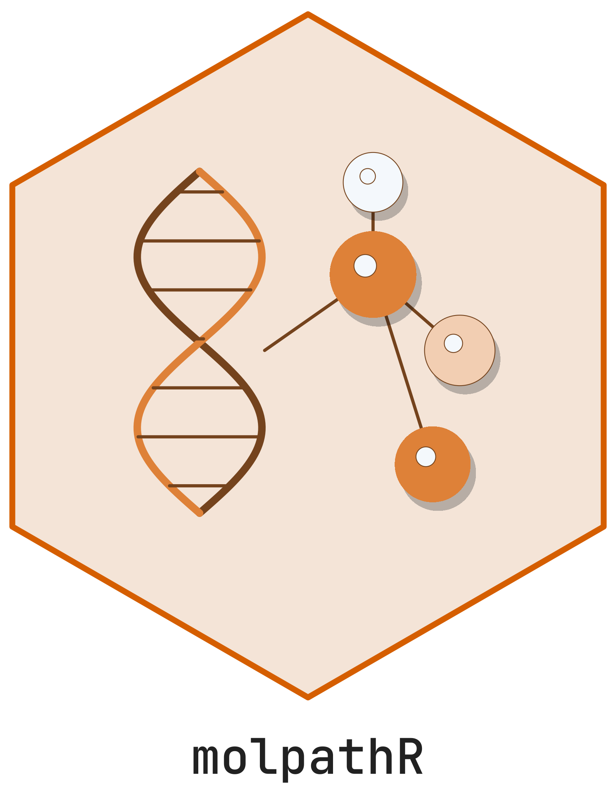

---
output:
  github_document:
    html_preview: false
---

<!-- README.md is generated from README.Rmd. Please edit that file -->

```{r, include = FALSE}
knitr::opts_chunk$set(
  collapse = TRUE,
  comment = "#>",
  fig.path = "man/figures/README-",
  out.width = "100%"
)
```

# molpathR <picture class="cttir-readme-logo"><source class="cttir-logo-dark-source" media="(prefers-color-scheme: dark)" srcset="man/figures/logo-with-name-dark.png" /></picture>

<!-- badges: start -->
[](https://github.com/CTTIR/molpathR/actions/workflows/R-CMD-check.yaml)
[](https://cttir.github.io/molpathR/)
[](https://CRAN.R-project.org/package=molpathR)
[](https://app.codecov.io/gh/CTTIR/molpathR?branch=main)
[](https://cran.r-project.org/package=molpathR)
[](https://cran.r-project.org/package=molpathR)
[](https://opensource.org/licenses/MIT)
[](https://lifecycle.r-lib.org/articles/stages.html#experimental)
<!-- badges: end -->

**molpathR** is a unified molecular pathology data platform that ingests
heterogeneous clinical and genomic data sources (VCF, BAM, FASTQ, XML reports,
PDF reports, clinical information systems, survival data), builds a queryable
in-memory database from explicitly identified records, and provides an
interactive Shiny application for exploratory cohort analysis. Raw FASTQ/BAM
readers expose sequences and alignments separately; they do not perform variant
calling or clinical interpretation. Unknown patient links and annotations remain
unknown. The package has not been qualified for diagnostic decision making.

## Installation

Use R 4.1 or later. On Windows and macOS, install the CRAN binaries from R:

```{r prerequisites, eval = FALSE}
install.packages("pdftools", repos = "https://cloud.r-project.org")
```

For a source installation of `pdftools`, install its system library first:

```sh
# Debian or Ubuntu
sudo apt-get install libpoppler-cpp-dev
# macOS with Homebrew, only when building pdftools from source
brew install poppler
```

See the [pdftools installation requirements](https://docs.ropensci.org/pdftools/)
for other platforms. These commands assume R and the platform's R compilation
toolchain are already installed. Then install the development source:

```{r install, eval = FALSE}
install.packages("remotes", repos = "https://cloud.r-project.org")
remotes::install_github("cttir/molpathR")
```

## Quick example

```{r example}
library(molpathR)

# Load example database with synthetic data
db <- mp_example_db(n_patients = 50, seed = 42)
db

# Query pathogenic TP53 variants
tp53 <- mp_query_variants(db, genes = "TP53", classification = "Pathogenic")
head(tp53[, c("sample_id", "gene", "variant", "classification", "vaf")])
```

```{r plot, fig.width = 8, fig.height = 5, fig.alt = "Kaplan-Meier curves by diagnosis for a synthetic cohort; time is measured in months."}
# Survival analysis by diagnosis
mp_plot_survival(db, group_by = "diagnosis", type = "os")
```

## Launch the Shiny app

```{r shiny, eval = FALSE}
mp_run_app(db)
```

## Features

- **Parsers** for VCF, raw FASTQ/BAM, XML reports, PDF text, clinical exports and survival data
- **Relational in-memory database** linking patients, samples, variants, reports, clinical, and survival data
- **Query engine** with tidy evaluation and free-text search
- **Exploratory plots**: variant landscapes, mutation spectra, survival curves, cohort overviews
- **Interactive Shiny application** with 6 tabs for clinical exploration

## Data integrity

`mp_validate_db(db)` reports incomplete patient/sample links, including missing
parent tables. The constructor rejects malformed schemas, conflicting primary
identities, impossible event codes and nonfinite measures. `mp_save_db()` verifies
a staged file before replacement; `mp_load_db()` validates its contents. Resolve
reported linkage issues before interpreting a cohort. Use one writer per saved
file.

The [data import guide](https://cttir.github.io/molpathR/articles/data-import.html)
contains a runnable synthetic pathology/clinical/survival import and explains VCF
and raw-read boundaries. Optional Bioconductor packages provide BAM/FASTQ readers;
strict text FASTQ and VCF paths are available as documented.

## Citation

Run `citation("molpathR")` and record the source version or commit used. This is a
development source milestone (0.1.0.9001), not a new release or Zenodo deposit.
The previously advertised draft DOI did not resolve during the maintenance audit;
use the repository citation until a public deposit is verified.

## Documentation

- [Getting Started](https://cttir.github.io/molpathR/articles/getting-started.html)
- [Data Import Guide](https://cttir.github.io/molpathR/articles/data-import.html)
- [Visualization Guide](https://cttir.github.io/molpathR/articles/visualization.html)
- [Shiny Application](https://cttir.github.io/molpathR/articles/shiny-app.html)

## License

MIT License. See [LICENSE.md](LICENSE.md) for details.

## Use of LLM tools

Where applicable, LLM tools were used for narrowly defined, non-authorial tasks:
copyediting, prose refinement, Markdown/LaTeX formatting, boilerplate scaffolding
(such as CI configurations and build scripts), and code refactoring. Tools included
[Chat AI](https://kisski.gwdg.de/leistungen/2-02-llm-service/), the KISSKI
(GWDG) service, and self-hosted **Mistral Small (24B, Apache-2.0)** served through
a local **vLLM architecture** on an Ubuntu Linux workstation with Intel
processors and NVIDIA GPUs. Self-hosted use also includes models that were
further trained (fine-tuned) or weight-edited in-house for specific tasks.
All self-hosted models ran locally, with no data sent to third parties.

All scientific claims, methodological choices, analyses, interpretations and
conclusions remain the authors' own. Where applicable, LLM-generated material
must be reviewed and revised before inclusion, and references must be verified
against their DOI, arXiv ID or ISBN.

Local software setup: vLLM with Python/PyTorch, plus R and RStudio.

## Branding

Editable R artwork and regeneration instructions are in [tools/branding](https://github.com/CTTIR/molpathR/blob/main/tools/branding/README.md).
