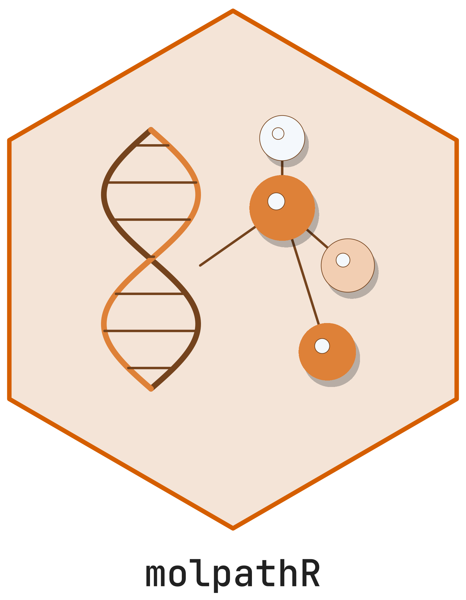

<!-- README.md is generated from README.Rmd. Please edit that file -->

```{r, include = FALSE}
knitr::opts_chunk$set(
  collapse = TRUE,
  comment = "#>",
  fig.path = "man/figures/README-",
  out.width = "100%"
)
```

# molpathR <picture class="cttir-readme-logo"><source class="cttir-logo-dark-source" media="(prefers-color-scheme: dark)" srcset="man/figures/logo-with-name-dark.png" /></picture>

<!-- badges: start -->
[](https://github.com/r-heller/molpathR/actions/workflows/R-CMD-check.yaml)
[](https://r-heller.github.io/molpathR/)
[](https://CRAN.R-project.org/package=molpathR)
[](https://app.codecov.io/gh/r-heller/molpathR?branch=main)
[](https://cran.r-project.org/package=molpathR)
[](https://cran.r-project.org/package=molpathR)
[](https://opensource.org/licenses/MIT)
[](https://lifecycle.r-lib.org/articles/stages.html#experimental)
<!-- badges: end -->

**molpathR** is a unified molecular pathology data platform that ingests
heterogeneous clinical and genomic data sources (VCF, BAM, FASTQ, XML reports,
PDF reports, clinical information systems, survival data), builds a queryable
in-memory database, and provides an interactive Shiny application for clinical
exploration and visualization.

## Installation

Install the development version from GitHub:

```{r install, eval = FALSE}
# install.packages("remotes")
remotes::install_github("cttir/molpathR")
```

## Quick example

```{r example}
library(molpathR)

# Load example database with synthetic data
db <- mp_example_db(n_patients = 50, seed = 42)
db

# Query pathogenic TP53 variants
tp53 <- mp_query_variants(db, genes = "TP53", classification = "Pathogenic")
head(tp53[, c("sample_id", "gene", "variant", "classification", "vaf")])
```

```{r plot, fig.width = 8, fig.height = 5}
# Survival analysis by diagnosis
mp_plot_survival(db, group_by = "diagnosis", type = "os")
```

## Launch the Shiny app

```{r shiny, eval = FALSE}
mp_run_app(db)
```

## Features

- **Parsers** for VCF, FASTQ, BAM, XML reports, PDF reports, clinical systems, and survival data
- **Relational in-memory database** linking patients, samples, variants, reports, clinical, and survival data
- **Query engine** with tidy evaluation and free-text search
- **Publication-ready plots**: variant landscapes, mutation spectra, survival curves, cohort overviews
- **Interactive Shiny application** with 6 tabs for clinical exploration

## Documentation

- [Getting Started](https://cttir.github.io/molpathR/articles/getting-started.html)
- [Data Import Guide](https://cttir.github.io/molpathR/articles/data-import.html)
- [Visualization Guide](https://cttir.github.io/molpathR/articles/visualization.html)
- [Shiny Application](https://cttir.github.io/molpathR/articles/shiny-app.html)

## License

MIT License. See [LICENSE.md](LICENSE.md) for details.

## Use of LLM tools

Where applicable, LLM tools were used for narrowly defined, non-authorial tasks:
copyediting, prose refinement, Markdown/LaTeX formatting, boilerplate scaffolding
(such as CI configurations and build scripts), and code refactoring. Tools included
[Chat AI](https://kisski.gwdg.de/leistungen/2-02-llm-service/), the KISSKI
(GWDG) service, and self-hosted **Mistral Small (24B, Apache-2.0)** served through
a local **vLLM architecture** on an Ubuntu Linux workstation with Intel
processors and NVIDIA GPUs. The self-hosted model ran locally, with no data sent
to third parties.

All scientific claims, methodological choices, analyses, interpretations and
conclusions remain the authors' own. Where applicable, LLM-generated material
must be reviewed and revised before inclusion, and references must be verified
against their DOI, arXiv ID or ISBN.

Local software setup: vLLM with Python/PyTorch, plus R and RStudio.

## Branding

Editable R artwork and regeneration instructions are in [tools/branding](https://github.com/CTTIR/molpathR/blob/main/tools/branding/README.md).
