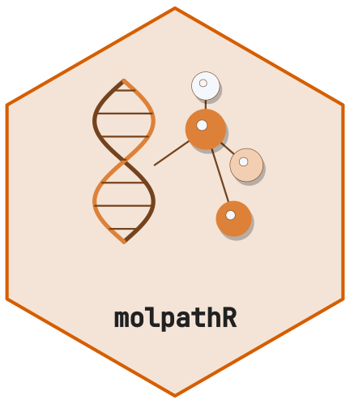

# Data Import Guide



[](https://github.com/CTTIR/molpathR/actions/workflows/R-CMD-check.yaml)
[](https://cttir.github.io/molpathR/)
[](https://CRAN.R-project.org/package=molpathR)
[](https://app.codecov.io/gh/CTTIR/molpathR?branch=main)
[](https://cran.r-project.org/package=molpathR)
[](https://cran.r-project.org/package=molpathR)
[](https://opensource.org/licenses/MIT)
[](https://lifecycle.r-lib.org/articles/stages.html#experimental)

## Scope

The six linked tables contain patients, samples, interpreted variants,
reports, clinical measurements and survival outcomes. Readers retain
source observations; the database does not infer patient identity,
annotation, pathogenicity or assay coverage from absent fields. Raw
FASTQ reads and BAM alignments remain inspectable reader results and
cannot be added as interpreted variants.

## A runnable import

This example uses only synthetic records and creates its own temporary
files. Identifiers are supplied explicitly, including the link from each
sample to a patient.

``` r

library(molpathR)
source_dir <- tempfile("molpath-example-")
dir.create(source_dir)
pathology <- file.path(source_dir, "pathology.csv")
clinical <- file.path(source_dir, "clinical.csv")
survival_file <- file.path(source_dir, "survival.csv")
writeLines(c(
  "patient_id,name,sex,sample_id,sample_type,diagnosis,report_date",
  "P1,Synthetic One,F,S1,FFPE,Example A,2025-01-01",
  "P2,Synthetic Two,M,S2,FFPE,Example B,2025-01-02"
), pathology)
writeLines(c(
  "patient_id;parameter;value;unit;date;source",
  "P1;marker;17;U;2025-01-01;synthetic",
  "P2;marker;23;U;2025-01-02;synthetic"
), clinical)
writeLines(c(
  "patient_id,os_months,os_status,pfs_months,pfs_status",
  "P1,12,0,8,0",
  "P2,18,1,10,1"
), survival_file)
db <- mp_build_db(
  mp_read_nexus_pathology(pathology),
  mp_read_nexus_clinical(clinical),
  mp_read_survival(survival_file)
)
#> ℹ Reading Nexus pathology export: pathology.csv
#> ✔ Parsed 2 record(s) from Nexus pathology export
#> ℹ Reading Nexus clinical export: clinical.csv
#> ✔ Parsed 2 clinical record(s)
#> ℹ Reading survival data: survival.csv
#> ✔ Parsed 2 patient record(s) with survival data
mp_validate_db(db)$valid
#> 
#> ── Validating molpath database ──
#> 
#> ✔ No referential integrity issues found.
#> 
#> ── Data completeness
#> • Patients with samples: 100%
#> • Patients with variants: 0%
#> • Patients with reports: 0%
#> • Patients with clinical: 100%
#> • Patients with survival: 100%
#> [1] TRUE
mp_get_patient(db, "P1")$clinical
#> # A tibble: 1 × 6
#>   patient_id parameter value date       source    unit 
#>   <chr>      <chr>     <chr> <date>     <chr>     <chr>
#> 1 P1         marker    17    2025-01-01 synthetic U
```

CSV, semicolon-delimited and tab-delimited exports are detected by their
actual fields. Field aliases match whole column names, ignoring case and
surrounding header whitespace. `patient_id_backup` is preserved as an
extra source column; it does not replace `patient_id`. Multiple
recognized aliases for one field are ambiguous and require
reconciliation. Survival event values must be exactly 0 (censored), 1
(event), or missing; fractional values are never truncated. Observed
times must be finite and nonnegative. Dates use ISO `YYYY-MM-DD` values.

## VCF calls and missing annotations

The reader preserves ID, INFO, FORMAT and each sample’s raw token
regardless of optional typed-reader installations. Original header lines
and declared sample names are in `parsed$metadata`. Database integration
expands observed non-reference GT alleles, while retaining source
genomic fields and genotype information. Each normalized row keeps its
original sample token in `sample_fields`, interpreted by `format`; raw
sample names cannot overwrite gene annotations or model identifiers. It
does not derive gene effects or pathogenicity from coordinates.

``` r

vcf <- file.path(source_dir, "calls.vcf")
writeLines(c(
  "##fileformat=VCFv4.2",
  "#CHROM\tPOS\tID\tREF\tALT\tQUAL\tFILTER\tINFO\tFORMAT\tS1\tS2",
  "1\t100\t.\tA\tG\t50\tPASS\tDP=50\tGT:DP\t0/1:20\t0/0:30"
), vcf)
parsed <- mp_read_vcf(vcf)
parsed$data
#> # A tibble: 1 × 11
#>   chrom   pos id    ref   alt    qual filter info  format S1     S2    
#>   <chr> <int> <chr> <chr> <chr> <dbl> <chr>  <chr> <chr>  <chr>  <chr> 
#> 1 1       100 .     A     G        50 PASS   DP=50 GT:DP  0/1:20 0/0:30
linked <- mp_add_data(db, parsed)
linked$variants[, c("sample_id", "variant", "genotype", "gene", "classification")]
#> # A tibble: 1 × 5
#>   sample_id variant   genotype gene  classification
#>   <chr>     <chr>     <chr>    <chr> <chr>         
#> 1 S1        1:100:A>G 0/1      NA    NA
mp_validate_db(linked)$valid
#> 
#> ── Validating molpath database ──
#> 
#> ✔ No referential integrity issues found.
#> 
#> ── Data completeness
#> • Patients with samples: 100%
#> • Patients with variants: 50%
#> • Patients with reports: 0%
#> • Patients with clinical: 100%
#> • Patients with survival: 100%
#> [1] TRUE
```

A site-only VCF or sample measurements without GT do not establish a
usable sample call. Inspect the parsed table, then supply an explicitly
normalized `sample_id`/`variant` table after independent
calling/annotation if that is the intended input. Reference or uncalled
genotypes are not evidence of a wild-type gene: the package has no
assay-coverage model.

## Reports and raw sequencing

| Reader | Stored observations and boundary |
|----|----|
| [`mp_read_xml_report()`](https://cttir.github.io/molpathR/reference/mp_read_xml_report.md) | Explicit XML patient/sample IDs and variant text; namespace-aware generic template |
| [`mp_read_pdf_report()`](https://cttir.github.io/molpathR/reference/mp_read_pdf_report.md) | Extracted text sections; no OCR or inferred patient/sample identity |
| [`mp_read_fastq()`](https://cttir.github.io/molpathR/reference/mp_read_fastq.md) | Raw read IDs, sequences and qualities; `n` selects the first records, not a random sample |
| [`mp_read_bam()`](https://cttir.github.io/molpathR/reference/mp_read_bam.md) | Explicit alignment fields, optionally restricted to one genomic region |
| [`mp_read_auto()`](https://cttir.github.io/molpathR/reference/mp_read_auto.md) | Recognized source schema; unrecognized or ambiguous tabular layouts raise an error |

The generic report templates are not vendor-certified. XML without a
known link and PDF text can remain incomplete report evidence; inspect
it before assigning an identity. The complete extracted PDF pages and
text are retained in parser metadata; report summaries use the full text
even when heuristic sections omit a heading. Image-only PDF reports
require an external, verified transcription or OCR process. FASTQ/BAM
database integration is refused because alignment and variant
interpretation are separate tasks. The raw reader results remain usable.

For an extensionless uploaded file, pass its original filename using
`mp_read_auto(path, source_name = "clinical.csv")`. Dispatch uses a
disposable copy with that filename and records its basename, not a
deleted upload path.

## Validation, merging and persistence

Constructed databases always contain the six typed tables. Missing
patient/sample links remain explicit and make `mp_validate_db(db)$valid`
false, even when the parent table is empty. Malformed schemas, nonfinite
measures, invalid event codes and duplicate primary IDs raise an error.
Merge identical records or complementary missing attributes; resolve
conflicting observed attributes deliberately.

``` r

saved <- file.path(source_dir, "database.rds")
mp_save_db(linked, saved)
#> 
#> ── Saving molpath database ──
#> 
#> ── Validating molpath database ──
#> 
#> ✔ No referential integrity issues found.
#> 
#> ── Data completeness
#> • Patients with samples: 100%
#> • Patients with variants: 50%
#> • Patients with reports: 0%
#> • Patients with clinical: 100%
#> • Patients with survival: 100%
#> ✔ Database saved to /tmp/RtmpPHsQGS/molpath-example-1d08264420cd/database.rds (1.2 KB).
restored <- mp_load_db(saved)
#> 
#> ── Loading molpath database ──
#> 
#> ✔ Database loaded from /tmp/RtmpPHsQGS/molpath-example-1d08264420cd/database.rds.
#> ℹ Contents: 2 patients, 2 samples, 1 variant, 0 reports, 2 clinical records, 2 survival records.
identical(restored, linked)
#> [1] TRUE
unlink(source_dir, recursive = TRUE)
```

Saving stages and verifies the complete RDS before replacement. A failed
replacement restores the previous destination or reports the preserved
recovery path. Use one writer per destination. Incomplete links are
reported on save and remain inspectable after reload; they are not
silently repaired.

Older zero-column empty tables and one-row metadata tibbles are
normalized on load. ISO date strings are normalized to `Date`. Malformed
nonempty tables or conflicting identities require explicit repair; keep
the original RDS and review the reported field rather than fabricating
missing clinical information.
