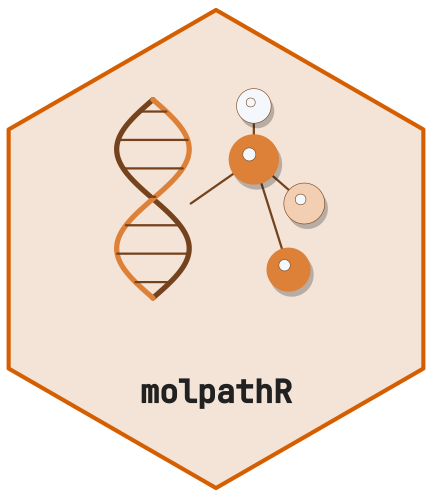

# Interactive Shiny Application



[](https://github.com/CTTIR/molpathR/actions/workflows/R-CMD-check.yaml)
[](https://cttir.github.io/molpathR/)
[](https://CRAN.R-project.org/package=molpathR)
[](https://app.codecov.io/gh/CTTIR/molpathR?branch=main)
[](https://cran.r-project.org/package=molpathR)
[](https://cran.r-project.org/package=molpathR)
[](https://opensource.org/licenses/MIT)
[](https://lifecycle.r-lib.org/articles/stages.html#experimental)

## Launching the app

``` r

library(molpathR)

# Launch with pre-loaded example data
db <- mp_example_db()
mp_run_app(db)

# Or launch empty and upload data in the browser
mp_run_app()
```

## Application tabs

### Tab 1: Database

The home tab lets you upload data files or load the example database. It
shows summary cards (number of patients, samples, variants, reports) and
a table of loaded data layers. Non-RDS files are staged using their
original filenames; a batch replaces session state only after every file
has parsed and validated. A failed upload retains the previous database.
Upload one database RDS by itself to replace the current database.
Incomplete cross-table links are reported explicitly, without inventing
missing patients or samples. Raw FASTQ/BAM files are available through
the R readers but require separately called and annotated variants
before they can be added to this database.

### Tab 2: Patients

A searchable, filterable master table of all patients. Click a row to
expand a detail panel showing that patient’s samples, variants, clinical
data, and survival information. Filters include diagnosis, sex, and age
range. Missing filter values are included by default and can be excluded
explicitly. Clear the patient selection to return linked views to the
whole cohort; replacing the database or changing patient filters clears
stale selections.

### Tab 3: Variants

Interactive variant table with gene, classification, and VAF filters.
Includes tabs for the variant landscape plot, mutation spectrum, and VAF
distribution. The figures and CSV download use the same current filtered
variant rows. Deselecting every available filter choice selects no known
values; the separate missing-value control governs unannotated values.
Clicking a variant selects its gene for survival stratification.

### Tab 4: Reports

Browse all parsed reports with filters for report type, date range, and
patient. Click a row to view the full report text in a detail panel.

### Tab 5: Survival

Interactive Kaplan-Meier curves with options for overall or
progression-free survival. Stratify by diagnosis, sex, or any gene
mutation status. Displays log-rank p-values and median survival
statistics. Gene selection from the Variants tab automatically
propagates here. Gene groups mean **recorded variant** and **no recorded
variant**. The database does not provide gene-level assay coverage: no
recorded variant is not proof of a negative assay or wild-type genotype.
The curve, summary and CSV use the same outcome and grouping records;
missing outcome/group values cannot contribute to that analysis.
Survival always uses the full cohort, independent of the Patients-tab
selection.

### Tab 6: Export

Select which data layers to export (patients, samples, variants,
reports, clinical, survival). Choose from CSV, TSV, Excel, or RDS
formats. Preview the data before downloading. These are full
database-layer exports, independent of the Patients/Variants table
filters; their individual CSV buttons export the filtered rows. CSV/TSV
are ZIP archives and require a `zip` executable on `PATH` or configured
with `R_ZIPCMD`. Excel requires the optional `writexl` package; if it is
unavailable, the app reports this rather than disguising another format.
Structured cells (for example PDF report sections) are encoded as JSON
strings in CSV, TSV and Excel; decode an individual cell with
[`jsonlite::fromJSON()`](https://jeroen.r-universe.dev/jsonlite/reference/fromJSON.html).
RDS preserves the native R structures. Partial RDS exports preserve all
six typed tables, with unselected layers empty, so unresolved links may
need attention after re-import.

## Cross-tab interactivity

- Selecting a patient in Tab 2 filters Variants and Reports to that
  patient. Each view displays its cohort; Survival remains a cohort
  analysis.
- Selecting a gene/variant in Tab 3 pre-fills the survival
  stratification gene

## Deployment

``` r

# Deploy to shinyapps.io
rsconnect::deployApp(
  appDir = system.file("shiny", "molpathR", package = "molpathR"),
  appName = "molpathR"
)
```
