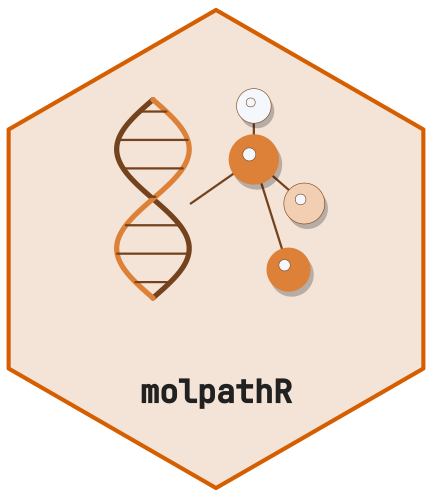

# Visualization Guide



[](https://github.com/CTTIR/molpathR/actions/workflows/R-CMD-check.yaml)
[](https://cttir.github.io/molpathR/)
[](https://CRAN.R-project.org/package=molpathR)
[](https://app.codecov.io/gh/CTTIR/molpathR?branch=main)
[](https://cran.r-project.org/package=molpathR)
[](https://cran.r-project.org/package=molpathR)
[](https://opensource.org/licenses/MIT)
[](https://lifecycle.r-lib.org/articles/stages.html#experimental)

## Overview

All molpathR plot functions return ggplot2 objects, so you can customize
them with standard ggplot2 syntax.

``` r

library(molpathR)
db <- mp_example_db(n_patients = 150, seed = 42)
```

## Variant landscape

``` r

mp_plot_variant_landscape(db, top_n = 10)
```


## VAF distribution

``` r

mp_plot_vaf_distribution(db, gene = "TP53")
```


## Survival analysis

``` r

# Overall survival by diagnosis
mp_plot_survival(db, group_by = "diagnosis", type = "os")
```


``` r

# Compare recorded TP53 variants with no recorded TP53 variant
mp_plot_survival(db, group_by = "TP53", type = "os")
```


The gene groups describe database records only. A patient with no
recorded variant is not established to be wild-type; assay coverage is
unavailable.

## Cohort overview

``` r

plots <- mp_plot_cohort_overview(db)
plots$diagnosis
```


``` r

plots$top_genes
```


## Patient timeline

``` r

pid <- db$patients$patient_id[1]
mp_plot_timeline(db, pid)
```


## Customization

All plots can be customized with ggplot2:

``` r

library(ggplot2)
mp_plot_vaf_distribution(db) +
  labs(title = "Custom Title") +
  theme(plot.title = element_text(colour = "purple"))
```


