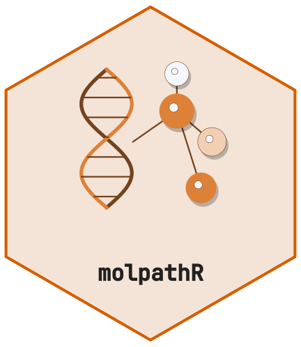
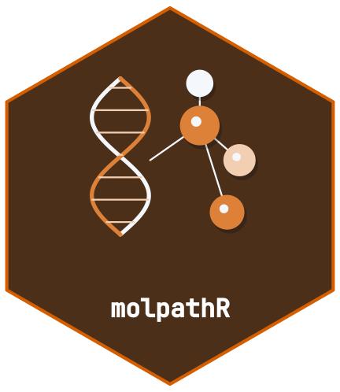

<!-- cttir-vignette-logo: start -->
<style>
.cttir-vignette-logo { float: right; width: 120px; max-width: 30%; margin: 0 0 1rem 1.5rem; }
.cttir-vignette-logo img { width: 100%; height: auto; border: 0; background: transparent; box-shadow: none; }
.cttir-vignette-logo .cttir-vignette-logo-light { display: block; }
.cttir-vignette-logo .cttir-vignette-logo-dark { display: none; }
@media (prefers-color-scheme: dark) {
  .cttir-vignette-logo .cttir-vignette-logo-light { display: none; }
  .cttir-vignette-logo .cttir-vignette-logo-dark { display: block; }
}
[data-bs-theme="light"] .cttir-vignette-logo .cttir-vignette-logo-light { display: block; }
[data-bs-theme="light"] .cttir-vignette-logo .cttir-vignette-logo-dark { display: none; }
[data-bs-theme="dark"] .cttir-vignette-logo .cttir-vignette-logo-light { display: none; }
[data-bs-theme="dark"] .cttir-vignette-logo .cttir-vignette-logo-dark { display: block; }
</style>
<div class="cttir-vignette-logo">
  
  
</div>
<!-- cttir-vignette-logo: end -->

<!-- badges: start -->
[](https://github.com/CTTIR/molpathR/actions/workflows/R-CMD-check.yaml)
[](https://cttir.github.io/molpathR/)
[](https://CRAN.R-project.org/package=molpathR)
[](https://app.codecov.io/gh/CTTIR/molpathR?branch=main)
[](https://cran.r-project.org/package=molpathR)
[](https://cran.r-project.org/package=molpathR)
[](https://opensource.org/licenses/MIT)
[](https://lifecycle.r-lib.org/articles/stages.html#experimental)
<!-- badges: end -->

```{r setup, include = FALSE}
knitr::opts_chunk$set(
  collapse = TRUE,
  comment = "#>",
  fig.width = 7,
  fig.height = 5
)
```

## Installation

Install molpathR from GitHub:

```{r install, eval = FALSE}
# install.packages("remotes")
remotes::install_github("cttir/molpathR")
```

## Quick start

Load the package and create an example database:

```{r load}
library(molpathR)
db <- mp_example_db(n_patients = 50, seed = 42)
db
```

## Explore the data

Get a cohort summary:

```{r summary}
mp_summary(db)
```

## Query patients

```{r query}
# Find melanoma patients over 60
melanoma <- mp_query_patients(db, diagnosis == "Melanoma", age > 60)
head(melanoma)
```

## Query variants

```{r variants}
# Pathogenic TP53 variants with VAF > 10%
tp53 <- mp_query_variants(db, genes = "TP53", classification = "Pathogenic", min_vaf = 0.1)
head(tp53)
```

## Visualize

```{r landscape, fig.width = 8, fig.height = 5}
mp_plot_variant_landscape(db, top_n = 10)
```

```{r survival, fig.width = 7, fig.height = 5}
mp_plot_survival(db, group_by = "diagnosis", type = "os")
```

## Launch the Shiny app

```{r shiny, eval = FALSE}
mp_run_app(db)
```
