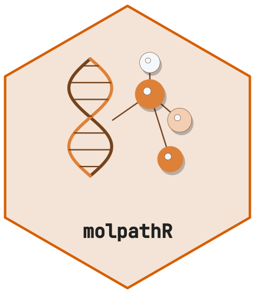
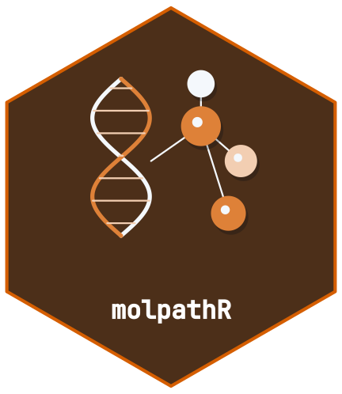

<!-- cttir-vignette-logo: start -->
<style>
.cttir-vignette-logo { float: right; width: 120px; max-width: 30%; margin: 0 0 1rem 1.5rem; }
.cttir-vignette-logo img { width: 100%; height: auto; border: 0; background: transparent; box-shadow: none; }
.cttir-vignette-logo .cttir-vignette-logo-light { display: block; }
.cttir-vignette-logo .cttir-vignette-logo-dark { display: none; }
@media (prefers-color-scheme: dark) {
  .cttir-vignette-logo .cttir-vignette-logo-light { display: none; }
  .cttir-vignette-logo .cttir-vignette-logo-dark { display: block; }
}
[data-bs-theme="light"] .cttir-vignette-logo .cttir-vignette-logo-light { display: block; }
[data-bs-theme="light"] .cttir-vignette-logo .cttir-vignette-logo-dark { display: none; }
[data-bs-theme="dark"] .cttir-vignette-logo .cttir-vignette-logo-light { display: none; }
[data-bs-theme="dark"] .cttir-vignette-logo .cttir-vignette-logo-dark { display: block; }
</style>
<div class="cttir-vignette-logo">
  
  
</div>
<!-- cttir-vignette-logo: end -->

<!-- badges: start -->
[](https://github.com/CTTIR/molpathR/actions/workflows/R-CMD-check.yaml)
[](https://cttir.github.io/molpathR/)
[](https://CRAN.R-project.org/package=molpathR)
[](https://app.codecov.io/gh/CTTIR/molpathR?branch=main)
[](https://cran.r-project.org/package=molpathR)
[](https://cran.r-project.org/package=molpathR)
[](https://opensource.org/licenses/MIT)
[](https://lifecycle.r-lib.org/articles/stages.html#experimental)
<!-- badges: end -->

```{r setup, include = FALSE}
knitr::opts_chunk$set(
  collapse = TRUE,
  comment = "#>",
  fig.width = 7,
  fig.height = 5
)
```

## Overview

All molpathR plot functions return ggplot2 objects, so you can customize them
with standard ggplot2 syntax.

```{r data}
library(molpathR)
db <- mp_example_db(n_patients = 150, seed = 42)
```

## Variant landscape

```{r landscape, fig.width = 9, fig.height = 6, fig.alt = "Recorded variant classifications across synthetic patients for selected genes."}
mp_plot_variant_landscape(db, top_n = 10)
```

## VAF distribution

```{r vaf, fig.alt = "Distribution of observed TP53 variant allele fractions in the synthetic cohort."}
mp_plot_vaf_distribution(db, gene = "TP53")
```

## Survival analysis

```{r survival, fig.alt = "Kaplan-Meier curves for synthetic patients grouped by diagnosis."}
# Overall survival by diagnosis
mp_plot_survival(db, group_by = "diagnosis", type = "os")
```

```{r survival_gene, fig.alt = "Kaplan-Meier curves comparing recorded TP53 variants with no recorded TP53 variant; missing records are not a negative assay."}
# Compare recorded TP53 variants with no recorded TP53 variant
mp_plot_survival(db, group_by = "TP53", type = "os")
```

The gene groups describe database records only. A patient with no recorded
variant is not established to be wild-type; assay coverage is unavailable.

## Cohort overview

```{r cohort, fig.alt = c("Synthetic patient counts by diagnosis.", "Recorded synthetic variant counts for the most frequent genes.")}
plots <- mp_plot_cohort_overview(db)
plots$diagnosis
plots$top_genes
```

## Patient timeline

```{r timeline, fig.alt = "Dated sample, report and clinical records for one synthetic patient."}
pid <- db$patients$patient_id[1]
mp_plot_timeline(db, pid)
```

## Customization

All plots can be customized with ggplot2:

```{r custom, fig.alt = "Distribution of synthetic variant allele fractions with a customized title and styling."}
library(ggplot2)
mp_plot_vaf_distribution(db) +
  labs(title = "Custom Title") +
  theme(plot.title = element_text(colour = "purple"))
```
